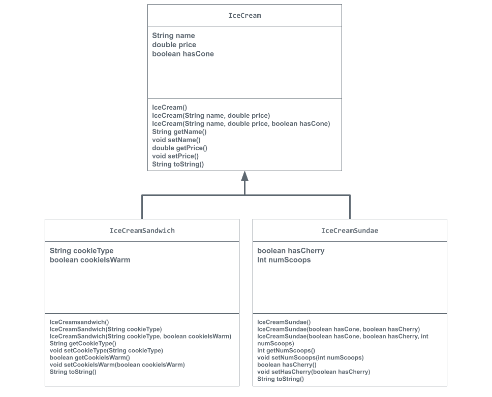

# store-management-project
# Unit 2 - Store Management Project

## Introduction

You are opening a new business in your community! Businesses often need programs to manage the products and services they offer and track orders and requests from customers. Your goal is to create a store management system for your business.

## Requirements

Use your knowledge of object-oriented programming and class structure and design to create your store management system:
- **Create a class hierarchy** – Develop a superclass that represents a product or service your business offers and one or more subclasses that extend the superclass to represent more specific types of products or services.
- **Declare instance variables** – Declare instance variables in the superclass that are shared with the subclasses and instance variables in the subclasses that are not shared with the superclass.
- **Write constructors** – Write no-argument and parameterized constructors in the superclass and subclasses. Subclass constructors use the super keyword to call the superclass constructor.
- **Implement accessor and mutator methods** – Write accessor and mutator methods for instance variables that should be accessible and/or modifiable from outside of the class.
- **Implement a toString() method** – Write toString() methods in the superclass and subclasses that return information about the state of an object.

## UML Diagram

## Description

1. Write a description of your project here. Include what your store you made, and why you chose this topic. In your description, include as many vocab words from our class to explain how you represented the item/service from your store. If you have user input, explain how the user will interact with your store such as which questions are prompted to the user, what response is your program expecting, and how that is used to output information for your store in the console.

My project is a program build using java which uses the concept of object oriented programming to create a program that represents an Ice Cream Shop's various products. The class IceCream is the super class of all other objects in the program, representing how it is the blueprint for all products in the shop. Below this in the class hierarchy are the classes of IceCreamSandwich and IceCreamSundae, which are bother subclasses of the superclass IceCream, representing how they are both products in the shop that have unique attributes and behaviors that aren't all shared with other products in the shop. The attributes are represented in java by instance variables for each object and the behaviors are represented by methods. Because IceCreamSundae and IceCreamSandwich are both subclasses of the superclass IceCream, through in inheritence they both inherit all of the methods and variables. I addition to making classes for this program I also integrated user input into the program by allowing the user to choose what product they want from the stop. The user is prompted by text that first welcomes them, then asks whcih product they would like to order. Because the products are listed numerically the user is expected to input an integer into the console which is used to determine not only which product they order, but what characteristics the product has. My program accomplishes this by taking in the user input of and intiger, using an if-else conditional statement to determine what product the user has selected, then it instantiates the given product with its given qualities and finally outputs text to the user that explains the product which they have picked.  I chose the topic of an Ice Cream Shop because I myself love ice cream, so I felt relatively confident in the topic itself.

2. How is this project related to STEAM (Science, Technology, Engineering, Art, and Mathematics)? Provide explicit examples from the project and details as possible. 

This project is related to STEAM because it revolves around the used of code in order to build a program that accomplishes a specific task. For this specific case, the code is in the language of java, which uses object oriented programming, and the task is to make a program that could be used for Store Management. This progect is highly linked to STEAM because of its centralization around java code, as it is used in many various STEAM fields. For example, this program uses multiple objects, such as IceCeam, IceCreamSandwich, and IceCreamSundae, which all have their own attributes and behaviors, just like how in the field of robotics all robots have their own  attributes and behaviors.

3. What SLOs did you demonstrate during completing this project?

Through the coarse of completing this project I demonstrated the SLOs of being a self-directed goal-oriented thinker and a critical thinker by completing the task of designing and creating a program used for store management through the actions of trying to most efficiently identify the goals and issues at hand, brainstorming and coming up with the best, quickest, and most convenient solution at hand, then excecuting on my ideas.